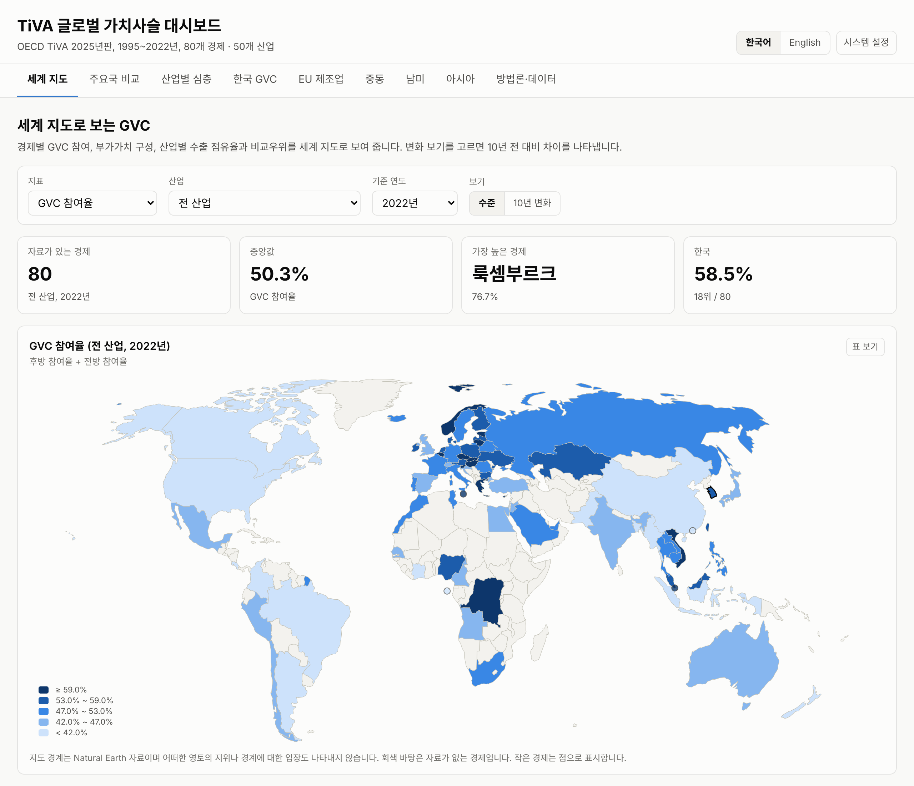
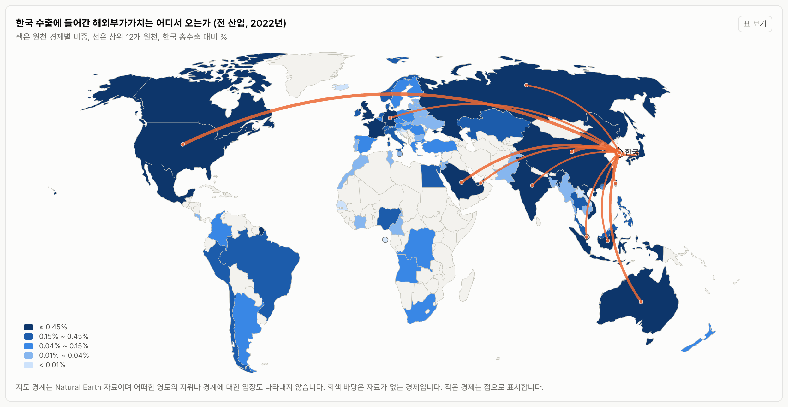

# OECD TiVA GVC 대시보드

[English](README.md) | **한국어**

OECD Trade in Value Added(TiVA) 데이터를 GitHub Actions로 자동 수집하고, 글로벌 가치사슬(GVC) 지표를 계산해 한국어·영어 GitHub Pages 대시보드로 보여 주는 저장소입니다.

**대시보드** https://jinawinwin.github.io/OECD_TiVA_GVC/?lang=ko



- **자료** OECD TiVA 2025년판 (1995~2022년, 80개 경제와 기타 세계, ISIC Rev.4 기반 50개 산업)
- **언어** 한국어와 영어. 머리글의 **한국어 | English** 탭으로 바꿀 수 있고, 주소에 `?lang=ko` 또는 `?lang=en`을 붙여 특정 언어로 공유할 수 있습니다. 둘 다 없으면 브라우저에 설정된 첫 번째 언어를 따릅니다.
- **갱신** 매월 5일 OECD API에서 TiVA 판 정보를 확인하고, 새 판이 있거나 설정이 바뀌었을 때만 전체를 다시 받습니다.

## 대시보드 구성

| 화면 | 내용 |
|---|---|
| 세계 지도 | 경제별 GVC 참여율, 후방·전방 참여율, 국내부가가치 비중, 산업별 수출 점유율과 RCA를 세계 지도로 표시. 10년 전 대비 변화 보기 제공 |
| 주요국 비교 | TiVA 부가가치(VALU) 상위 20개 경제의 후방·전방·GVC 참여율, 국내부가가치 비중, 추이 비교 |
| 산업별 심층 | 수출 점유율·RCA·후방 참여율 지도, 50개 산업과 집계 산업별 세계 수출, 상위 수출 경제, DVA·FVA 구성, 집중도(HHI), 부가가치 기준 RCA. 중점 산업(반도체·전자, 이차전지·전기장비, 정유, 조선, 자동차, 화학)은 해외부가가치 원천 흐름 지도, 원천국 히트맵, 전방 연계, 수출 대상의 부가가치 구성을 추가로 제공 |
| 한국 GVC | 한국과 연결된 부가가치 흐름 지도(후방 원천, 전방 제3국 수출), 참여율 추이, 경쟁국(일본·중국·대만·독일·미국) 비교, 제조업 세부 산업 구조, 해외부가가치 원천과 주요 원천국 의존도, 총수출과 최종수요 부가가치 기준 수출 대상 비교 |
| EU 제조업 · 중동 · 남미 · 아시아 | 회원국 지표 지도, 회원국 합계 지표, 회원국 비교 표와 추이, 산업 구성과 RCA, 역내 조달 비중, 해외부가가치의 역내·역외 원천 |
| 방법론·데이터 | 지표 정의, 산업·국가군 대응, 해석상 유의점, 자동 품질 점검 결과 |



모든 차트와 지도에는 같은 값을 담은 표 보기가 있고, 밝은 화면과 어두운 화면을 지원합니다. 지도 경계는 Natural Earth 1:110m(world-atlas)이며 어떠한 영토의 지위나 경계에 대한 입장도 나타내지 않습니다. 이 축척에 없는 홍콩·싱가포르·몰타·상투메프린시페는 점으로 표시합니다.

## 처음 설정 (한 번만)

1. 저장소 **Settings → Pages → Build and deployment → Source** 를 **GitHub Actions** 로 바꿉니다.
2. **Settings → Actions → General → Workflow permissions** 가 **Read and write permissions** 인지 확인합니다. 수집한 데이터를 저장소에 커밋하는 데 필요합니다.
3. **Actions → TiVA update and deploy (데이터 갱신 및 배포) → Run workflow** 를 누릅니다. 전체 수집은 OECD API 요청 70건 정도이며, API 사용량 제한 때문에 45분 안팎 걸립니다.
4. 실행이 끝나면 `data/processed/` 와 `docs/data/` 에 데이터가 커밋되고 대시보드가 배포됩니다.

`main` 브랜치에 코드나 설정을 push해도 같은 워크플로가 실행됩니다. 이때 OECD 판이 바뀌지 않았다면 데이터는 다시 받지 않고 대시보드만 다시 만듭니다.

## 저장소 구조

```
config/
  tiva.yaml               수집 범위 (지표, 국가, 산업, 연도, API 요청 설정)
  groups.yaml             국가군, 중점 산업, 한국어·영어 표기
scripts/
  sdmx.py                 OECD SDMX API 클라이언트 (구조 탐색, 분할 요청, 재시도)
  fetch_tiva.py           수집 → data/processed/*.parquet
  build_dashboard_data.py 지표 계산 → docs/data/*.json, data/processed/country_summary.csv
docs/                     GitHub Pages 대시보드 (정적 HTML, ECharts, d3-geo, Natural Earth 경계)
data/processed/           정리된 데이터 (연구용으로 바로 사용 가능)
tests/                    모의 OECD 서버와 로컬 검증 스크립트
.github/workflows/        tiva.yml (갱신·배포), probe.yml (API 진단)
```

## 수집 방식

OECD는 TiVA dataflow를 기본 주소(`sdmx.oecd.org/public/rest`)에 외부 참조로 등록하고, 실제 구조와 데이터는 `sdmx.oecd.org/sti-public/rest`에서 제공합니다. `fetch_tiva.py`는 기관 `OECD.STI.PIE`에서 id에 `TIVA`가 들어간 dataflow 중 최신 판을 고르고, 외부 참조 주소를 따라가 구조(DSD, 코드목록, 내용 제약)를 읽습니다. 그다음 `config/tiva.yaml`의 블록마다 필요한 코드만 골라 받습니다.

| 블록 | dataflow | 내용 |
|---|---|---|
| levels | Principal Indicators, levels (MAINLV) | 국가 × 산업 × 연도 수준값, 상대국 세계 (EXGR, IMGR, EXGR_INT, EXGR_DVA, EXGR_FVA, VALU, FFD_DVA, DFD_FVA) |
| shares | Principal Indicators, shares (MAINSH) | 총수출 대비 비중 (EXGR_DVA, EXGR_FVA, FEXGR_DVA). FEXGR_DVA의 산업별 값은 외국의 해당 산업 수출에 체화된 자국 부가가치라서 점검용으로만 사용 |
| forward_source | EXGRVA | 원천 경제·산업의 부가가치가 제3국 수출에 체화된 크기 IV (원천 × 수출 경제 전체를 받아 받는 즉시 제3국 합계로 줄여 저장, 산업별 전방 참여율 계산용) |
| destination | MAINLV | 수출 대상국별 총수출과 최종수요 부가가치 |
| origin_backward | Origin of value added in gross exports (EXGRVA) | 수출 경제·산업의 총수출에 들어간 원천 경제별 부가가치 |
| origin_forward | EXGRVA | 원천 경제·산업의 부가가치가 상대 경제 수출에 체화된 크기 |

상대국 블록은 2000, 2005, 2010, 2015년과 최근 5년, 전 산업·제조업·중점 산업으로 한정합니다. 2025년판 API는 지침서의 지표 코드(EXGR_FVASH 등) 대신 측정 단위 차원(UNIT_MEASURE)으로 비중의 기준을 구분하므로, 위처럼 실제 API 코드로 받습니다.

한 요청의 크기가 설정값을 넘으면 코드 수가 많은 차원부터 나눠 요청하고, 서버가 응답 크기를 이유로 거절하면 더 잘게 나눠 다시 시도합니다. HTTP 429는 `Retry-After`를 따릅니다. 받은 조각은 `data/cache/`에 저장되어 중단 후 재실행 시 이어서 받습니다. 범위를 바꾸려면 `config/tiva.yaml`을 고치고 push하면 됩니다.

API 응답 형태가 바뀐 것으로 보이면 Actions의 **OECD API probe (API 진단)** 워크플로를 실행하면 구조와 소량 데이터를 확인할 수 있습니다.

## 정리된 데이터 사용

| 파일 | 내용 |
|---|---|
| `data/processed/tiva_levels.parquet` | MEASURE, REF_AREA, ACTIVITY, COUNTERPART_AREA(W), UNIT_MEASURE, year, value (백만 달러) |
| `data/processed/tiva_shares.parquet` | 위와 같은 차원, 비중 (%) |
| `data/processed/tiva_forward_source.parquet` | 원천 경제·산업별 제3국 수출 체화 부가가치 IV (백만 달러) |
| `data/processed/tiva_destination.parquet` | 수출 대상국별 EXGR, FFD_DVA (백만 달러) |
| `data/processed/tiva_origin_backward.parquet`, `tiva_origin_forward.parquet` | EXGRVA 원천·수출 경제와 산업별 부가가치 (백만 달러) |
| `data/processed/country_summary.csv` | 국가·지역별 전 산업·제조업 핵심 지표 (후방·전방·GVC 참여율 포함) |
| `data/processed/manifest.json` | 사용한 dataflow, 판, 최신 연도, 행 수 |

```python
import pandas as pd
lv = pd.read_parquet("data/processed/tiva_levels.parquet")
kor = lv.query("REF_AREA == 'KOR' and ACTIVITY == 'C26' and MEASURE == 'EXGR_FVA'")
```

R에서는 `arrow::read_parquet()` 로 읽을 수 있고, Stata에서는 `country_summary.csv` 를 쓰거나 parquet을 CSV로 변환해 사용합니다.

## 지표 정의 요약

| 지표 | 정의 |
|---|---|
| 후방 참여율 | 총수출 중 해외부가가치 비중 (EXGR_FVA, PT_EXGR) |
| 전방 참여율 | 자국(해당 산업)이 창출한 부가가치 중 제3국 수출에 체화된 부분(IV), 총수출(해당 산업 총수출) 대비. Koopman et al. (2010) 방식, EXGRVA로 계산하며 전 산업 값은 공식 FEXGR_DVA와 같음 |
| GVC 참여율 | 후방 참여율 + 전방 참여율 |
| 세계 수출 점유율 | 개별 경제(기타 세계 포함) 총수출 합계 대비 |
| 부가가치 기준 RCA | (경제의 산업 수출 DVA / 경제 전체 수출 DVA) ÷ (세계 산업 수출 DVA / 세계 전체 수출 DVA) |
| 역내 조달 비중 | 지역 해외부가가치 중 회원국 원천 비중 (EXGRVA 기반) |

지역 지표는 회원국 값을 합산해 계산하므로 회원국 간 교역이 포함됩니다. TiVA 공식 집계(EU27_2020, ASEAN)는 지역을 하나의 경제로 보아 역외 교역만 반영하므로 수준이 다릅니다. 지표는 국가·산업 간 연관성을 보여 주며 인과관계를 뜻하지 않습니다.

TiVA는 ISIC Rev.4 기반 50개 산업이라 반도체나 이차전지를 따로 분리하지 않습니다. 중점 산업은 아래처럼 해당 산업을 포함하는 TiVA 산업으로 대응시켰고, 결과는 그 산업 전체 값입니다.

| 중점 산업 | TiVA 산업 |
|---|---|
| 반도체·전자 | C26 컴퓨터·전자·광학기기 |
| 이차전지·전기장비 | C27 전기장비. 양극재 등 소재는 C20, 니켈·코발트 등 비철금속 제련은 C242_2432(1차 비철금속)에 속함 |
| 정유 | C19 코크스·석유정제품 |
| 조선 | C301 선박 건조 |
| 자동차 | C29 자동차·트레일러 |
| 화학 | C20 화학물질·화학제품 |

## 로컬 실행

```bash
pip install -r requirements.txt
python scripts/fetch_tiva.py          # OECD API 접근이 가능한 환경에서
python scripts/build_dashboard_data.py
python -m http.server -d docs 8000    # http://localhost:8000
```

수집·가공 코드는 모의 OECD 서버로 검증할 수 있습니다. 합성 데이터를 쓰며 저장소의 데이터 폴더는 건드리지 않습니다.

```bash
bash tests/run_mock_test.sh
```

## 출처와 라이선스

- 데이터 OECD (2025), Trade in Value Added (TiVA) database. OECD 데이터 이용 조건에 따라 출처를 표시해 사용합니다.
- 차트 라이브러리 Apache ECharts 5.6 (Apache License 2.0), 지도 투영 d3-geo·d3-array (ISC), `docs/assets/vendor/`
- 지도 경계 Natural Earth (공공 영역), world-atlas 2.0.2 (ISC), `docs/assets/geo/`
- Koopman, R., Powers, W., Wang, Z. and Wei, S.-J. (2010), "Give Credit Where Credit Is Due: Tracing Value Added in Global Production Chains", NBER Working Paper 16426.
