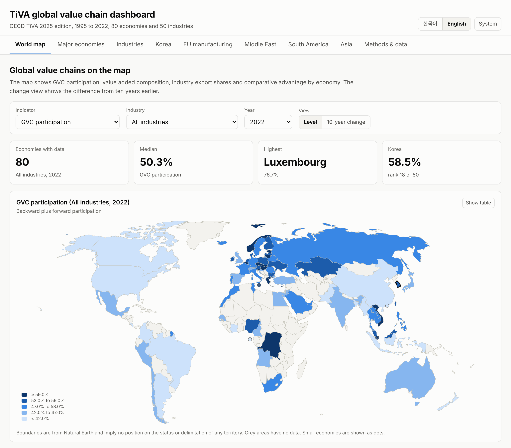
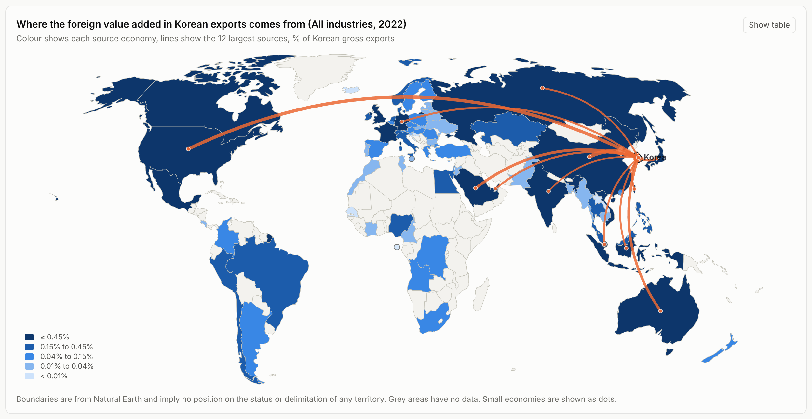

# OECD TiVA GVC dashboard

**English** | [한국어](README.ko.md)

This repository collects OECD Trade in Value Added (TiVA) data with GitHub Actions, computes global value chain (GVC) indicators and publishes them as a bilingual dashboard on GitHub Pages.

**Dashboard** https://jinawinwin.github.io/OECD_TiVA_GVC/?lang=en



- **Data** OECD TiVA 2025 edition, 1995 to 2022, 80 economies and the rest of the world, 50 industries (ISIC Rev.4)
- **Languages** English and Korean. Use the **한국어 | English** tab in the header, or add `?lang=en` or `?lang=ko` to the address to share a specific language. Without either, the dashboard follows the first language set in the browser.
- **Updates** On the 5th of every month GitHub Actions checks the TiVA edition on the OECD API and downloads the full data again only when a new edition is released or the configuration changes.

## Dashboard views

| View | Contents |
|---|---|
| World map | GVC participation, backward and forward participation, domestic value added share, intermediates share, industry export shares and value-added RCA by economy, with a ten-year change view |
| Major economies | The 20 largest economies by TiVA value added (VALU), compared on backward, forward and GVC participation and the domestic value added share, with trends over time |
| Industries | Maps of export share, RCA and backward participation, world exports, leading exporters, domestic and foreign value added, concentration (HHI) and value-added RCA for 50 industries and aggregates. Focus industries (semiconductors and electronics, batteries and electrical equipment, oil refining, shipbuilding, motor vehicles, chemicals) add a flow map of foreign value added sources, a source heatmap, forward linkages and destinations in value added terms |
| Korea | Flow maps of value added linked to Korea (backward sources and forward third-country exports), participation over time, comparison with Japan, China, Chinese Taipei, Germany and the United States, manufacturing structure, sources of foreign value added and export destinations in gross and value added terms |
| EU manufacturing, Middle East, South America, Asia | Member maps, regional totals, a member comparison table and trends, industry composition and RCA, intra-regional sourcing and intra- and extra-regional sources of foreign value added |
| Methods and data | Indicator definitions, industry and country group mapping, notes on interpretation and automated quality checks |



Every chart and map has a table view with the same values, and the dashboard supports light and dark themes. Boundaries come from Natural Earth at 1:110m (world-atlas) and imply no position on the status or delimitation of any territory. Hong Kong, Singapore, Malta and Sao Tome and Principe are too small for this scale and appear as dots.

## Setting up (once)

1. In the repository, set **Settings → Pages → Build and deployment → Source** to **GitHub Actions**.
2. Check that **Settings → Actions → General → Workflow permissions** is set to **Read and write permissions**. The workflow needs this to commit the collected data.
3. Open **Actions → TiVA update and deploy (데이터 갱신 및 배포) → Run workflow**. A full collection sends about 70 requests to the OECD API and takes around 45 minutes because of the API rate limits.
4. When the run finishes, the data are committed to `data/processed/` and `docs/data/` and the dashboard is deployed.

A push to `main` that changes the code or configuration starts the same workflow. If neither the OECD edition nor the configuration has changed, the data are not downloaded again and only the dashboard is rebuilt.

## Repository layout

```
config/
  tiva.yaml               collection scope (indicators, economies, industries, years, API settings)
  groups.yaml             country groups, focus industries, Korean and English labels
scripts/
  sdmx.py                 OECD SDMX API client (structure discovery, split requests, retries)
  fetch_tiva.py           collection → data/processed/*.parquet
  build_dashboard_data.py indicator calculation → docs/data/*.json, data/processed/country_summary.csv
docs/                     GitHub Pages dashboard (static HTML, ECharts, d3-geo, Natural Earth boundaries)
data/processed/           processed data, ready for research use
tests/                    mock OECD server and local checks
.github/workflows/        tiva.yml (update and deploy), probe.yml (API probe)
```

## How the data are collected

The OECD registers the TiVA dataflows at the main address (`sdmx.oecd.org/public/rest`) as external references and serves the structures and data from `sdmx.oecd.org/sti-public/rest`. `fetch_tiva.py` selects the latest edition among the `OECD.STI.PIE` dataflows whose id contains `TIVA`, follows the external reference and reads the structure (data structure definition, codelists and content constraints). It then requests only the codes needed for each block in `config/tiva.yaml`.

| Block | Dataflow | Contents |
|---|---|---|
| levels | Principal Indicators, levels (MAINLV) | Economy × industry × year values with the world as partner (EXGR, IMGR, EXGR_INT, EXGR_DVA, EXGR_FVA, VALU, FFD_DVA, DFD_FVA) |
| shares | Principal Indicators, shares (MAINSH) | Shares of gross exports (EXGR_DVA, EXGR_FVA, FEXGR_DVA). The industry breakdown of FEXGR_DVA refers to the foreign exporting industry, so it is used only as a check |
| forward_source | EXGRVA | Value added of each source economy and industry embodied in third-country exports (IV). The full source × exporter matrix is downloaded and reduced to third-country totals as it arrives. Used for forward participation by industry |
| destination | MAINLV | Gross exports and value added in final demand by partner |
| origin_backward | Origin of value added in gross exports (EXGRVA) | Value added from each source economy in the gross exports of each exporting economy and industry |
| origin_forward | EXGRVA | Value added of each source economy and industry embodied in each partner's exports |

Partner blocks cover 2000, 2005, 2010, 2015 and the latest five years, for all industries, manufacturing and the focus industries. The 2025 edition of the API distinguishes share bases with a unit of measure dimension (UNIT_MEASURE) rather than the indicator codes in the TiVA guide (such as EXGR_FVASH), so the collection uses the codes the API actually serves.

When a request would exceed the configured size, it is split along the dimension with the most codes, and requests that the server rejects for size are split further and retried. HTTP 429 responses follow `Retry-After`. Downloaded pieces are cached in `data/cache/`, so an interrupted run resumes where it stopped. To change the scope, edit `config/tiva.yaml` and push.

If the API response format appears to have changed, run the **OECD API probe (API 진단)** workflow in Actions to inspect the structures and a small data sample.

## Using the processed data

| File | Contents |
|---|---|
| `data/processed/tiva_levels.parquet` | MEASURE, REF_AREA, ACTIVITY, COUNTERPART_AREA (W), UNIT_MEASURE, year, value (USD million) |
| `data/processed/tiva_shares.parquet` | Same dimensions, shares (%) |
| `data/processed/tiva_forward_source.parquet` | Value added embodied in third-country exports by source economy and industry (USD million) |
| `data/processed/tiva_destination.parquet` | EXGR and FFD_DVA by partner (USD million) |
| `data/processed/tiva_origin_backward.parquet`, `tiva_origin_forward.parquet` | EXGRVA value added by source and exporting economy and industry (USD million) |
| `data/processed/country_summary.csv` | Main indicators for economies and regions, all industries and manufacturing (including backward, forward and GVC participation) |
| `data/processed/manifest.json` | Dataflows, edition, latest year and row counts |

```python
import pandas as pd
lv = pd.read_parquet("data/processed/tiva_levels.parquet")
kor = lv.query("REF_AREA == 'KOR' and ACTIVITY == 'C26' and MEASURE == 'EXGR_FVA'")
```

In R the files can be read with `arrow::read_parquet()`. In Stata, use `country_summary.csv` or convert the parquet files to CSV first.

## Indicator definitions

| Indicator | Definition |
|---|---|
| Backward participation | Foreign value added as a share of gross exports (EXGR_FVA, unit PT_EXGR) |
| Forward participation | Value added created by the economy (or industry) that is embodied in third-country exports (IV), as a share of gross exports (or the industry's gross exports). Follows Koopman et al. (2010) and is computed from EXGRVA. The all-industry value equals the official FEXGR_DVA |
| GVC participation | Backward plus forward participation |
| World export share | Share of the gross exports of all TiVA economies, including the rest of the world |
| Value-added RCA | (Industry DVA in exports / total DVA in exports of the economy) divided by (industry DVA in exports / total DVA in exports of the world) |
| Intra-regional sourcing | Share of a region's foreign value added that comes from its members (from EXGRVA) |

Regional indicators sum the members' values and therefore include trade among members. Official TiVA aggregates such as EU27_2020 or ASEAN treat the region as a single economy covering extra-regional trade only, so their levels differ. The indicators describe associations between economies and industries and do not imply causation.

TiVA covers 50 industries based on ISIC Rev.4 and does not separate products such as semiconductors or batteries. Each focus industry is mapped to the TiVA industry that contains it, so the results refer to that whole industry.

| Focus industry | TiVA industry |
|---|---|
| Semiconductors and electronics | C26 Computer, electronic and optical products |
| Batteries and electrical equipment | C27 Electrical equipment. Cathode and other materials fall under C20 and nickel, cobalt and other non-ferrous metal refining under C242_2432 |
| Oil refining | C19 Coke and refined petroleum products |
| Shipbuilding | C301 Building of ships and boats |
| Motor vehicles | C29 Motor vehicles, trailers and semi-trailers |
| Chemicals | C20 Chemicals and chemical products |

## Running locally

```bash
pip install -r requirements.txt
python scripts/fetch_tiva.py          # needs access to the OECD API
python scripts/build_dashboard_data.py
python -m http.server -d docs 8000    # http://localhost:8000
```

The collection and processing code can be checked against a mock OECD server. It uses synthetic data and leaves the repository's data folders untouched.

```bash
bash tests/run_mock_test.sh
```

## Sources and licences

- Data from OECD (2025), Trade in Value Added (TiVA) database, used with attribution under the OECD terms and conditions.
- Charts use Apache ECharts 5.6 (Apache License 2.0) and map projections use d3-geo and d3-array (ISC), in `docs/assets/vendor/`.
- Boundaries come from Natural Earth (public domain) through world-atlas 2.0.2 (ISC), in `docs/assets/geo/`.
- Koopman, R., Powers, W., Wang, Z. and Wei, S.-J. (2010), "Give Credit Where Credit Is Due: Tracing Value Added in Global Production Chains", NBER Working Paper 16426.
